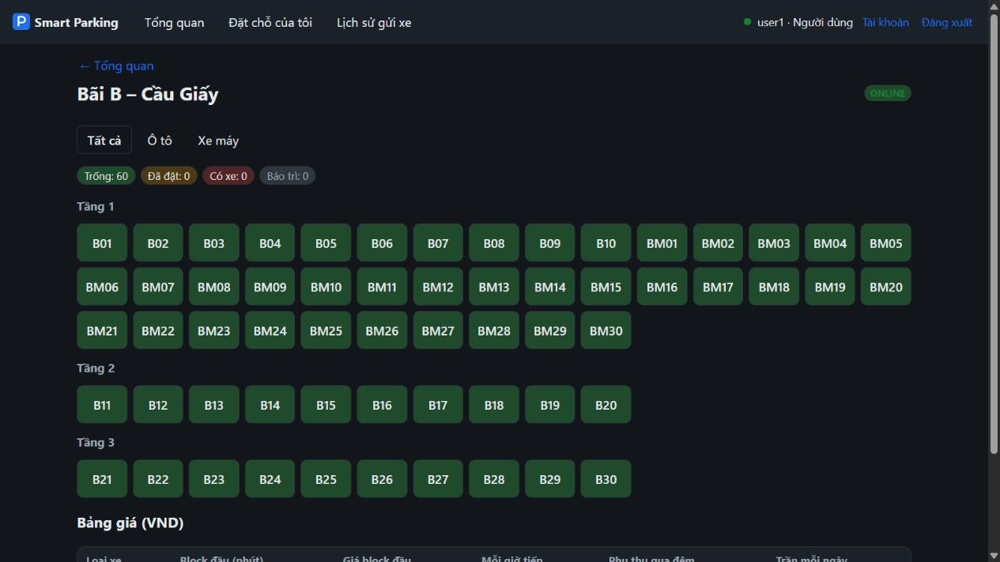
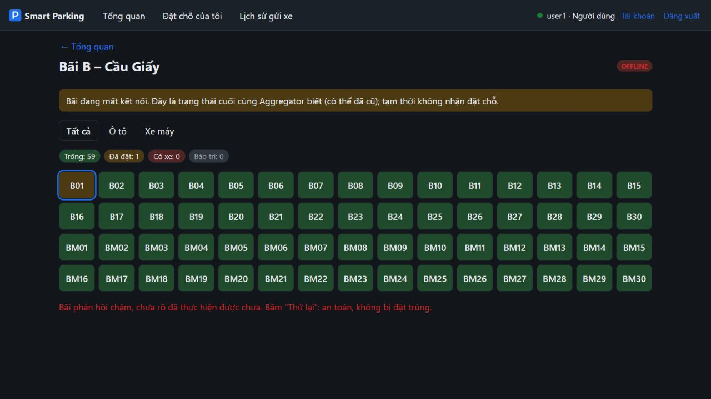
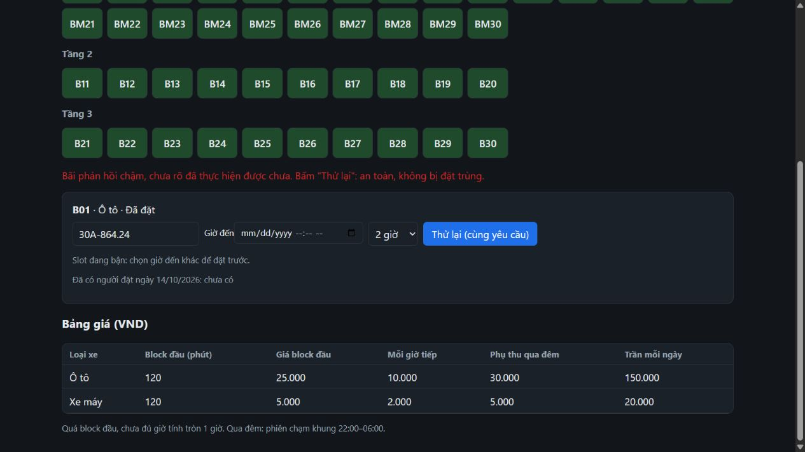
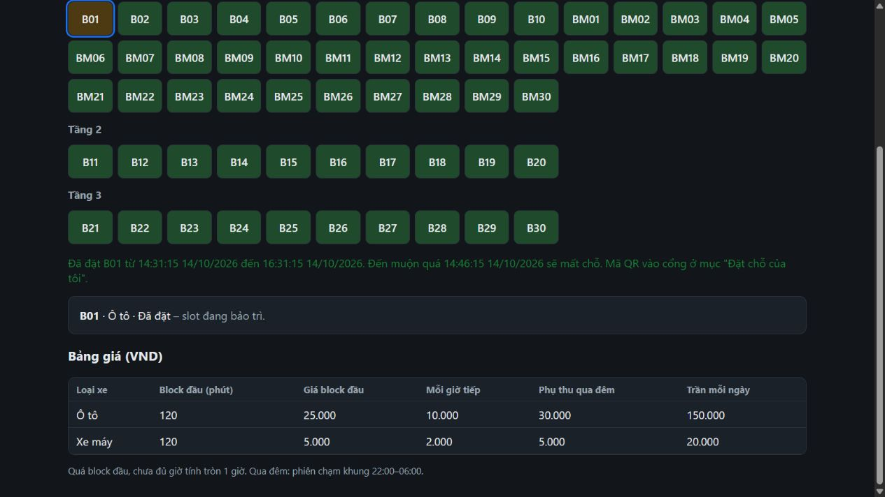
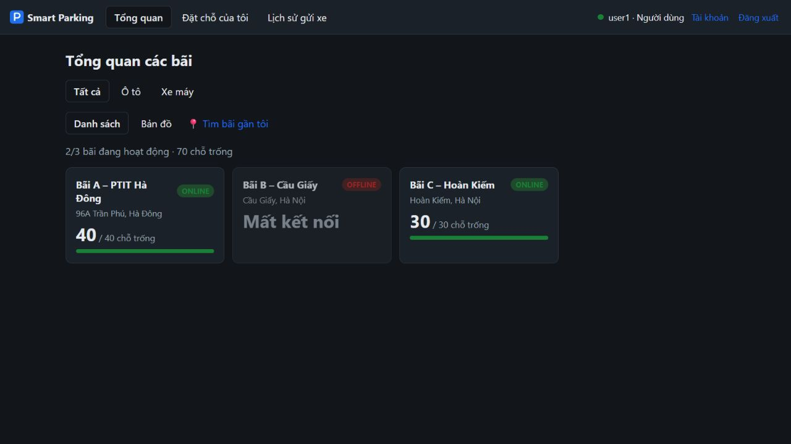
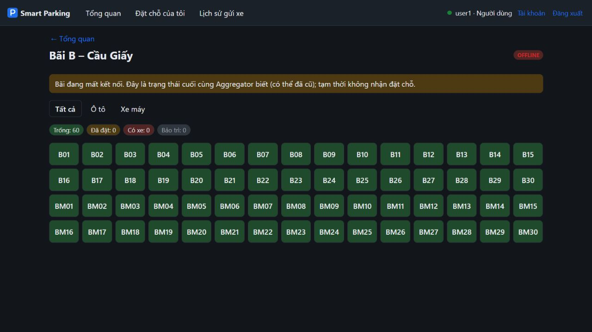
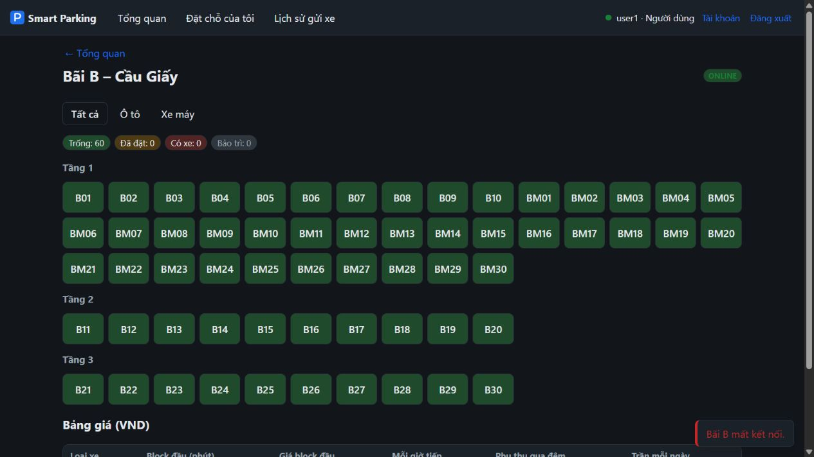
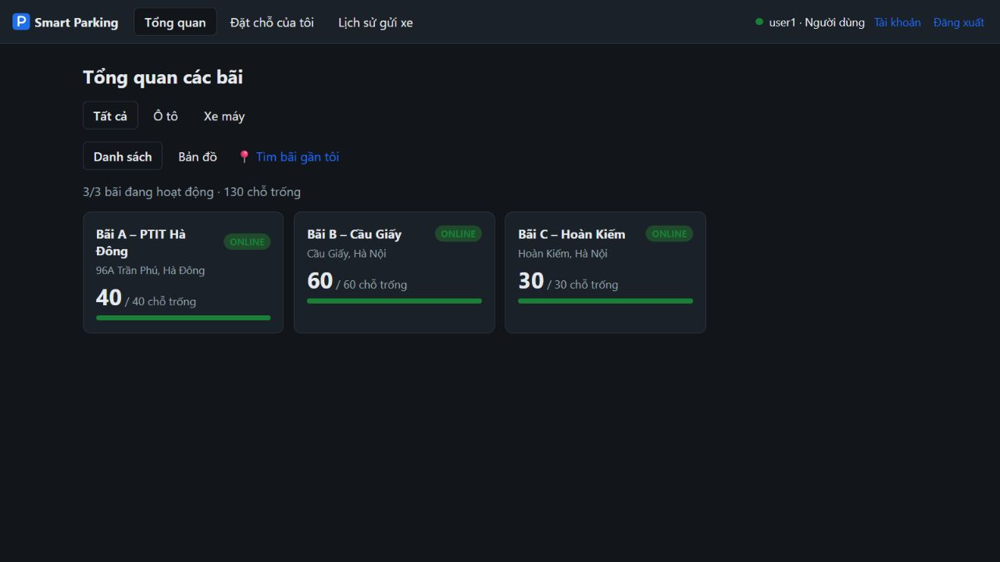

# PT-06.4 — Kết quả chạy 4 kịch bản mạng xấu

Đã chạy thực tế cả 4 kịch bản, quan sát giao diện và kiểm tra HTTP/DB. TC47 đạt. Sau khi kết thúc, proxy B được bật, không còn toxic, cả A/B/C ONLINE và dữ liệu đặt chỗ test đã được huỷ qua API.

## Môi trường và phạm vi

- Thời điểm đo chính: **14/10/2026, 14:28–14:35 (UTC+7)**. Các mốc log dưới đây đã đổi từ UTC sang UTC+7.
- Windows 11; PowerShell; Node.js **v24.11.0**; Docker Engine **29.1.5**; Docker Compose **5.0.1**.
- Nhánh thực hiện: `codex/hung-pt-06-4`, tạo từ `dev` sau fetch và cập nhật fast-forward.
- Commit được kiểm thử: **`1519d4c8b924c9376265db8880a1bfc5f439b900`**. Không sửa code service, frontend, script mạng hoặc TC47.
- Điều kiện việc trước: người dùng đã xác nhận kiểm tra NV-08.8; `origin/hung` có commit `d3883517ee7d30e9105f013b061d6598256c1bf5`, PR #8. NV-08.8 chưa nằm trong commit dev này.
- Một Aggregator, ba parking-node, PostgreSQL và RabbitMQ; profile **chaos**, Toxiproxy **2.9.0**. Không bật HA/obs/extra.
- Web qua nginx: `http://localhost:3000`; API Aggregator trực tiếp: `http://localhost:8000`; API điều khiển Toxiproxy: `http://localhost:8474`.
- Đường bị gây lỗi: Aggregator → `toxiproxy:18002` → `parking-b:8002`. API node B trên cổng 8002 vẫn có đường truy cập trực tiếp.
- Giao diện được thao tác và chụp thật bằng trình duyệt trong Codex, đăng nhập tài khoản demo `user1`. Ảnh không chứa token hoặc mật khẩu.

### Điều chỉnh môi trường cục bộ

Docker đã có đủ các service trong repository; chỉ tải image Toxiproxy đã được khai báo. Không xây thêm service hoặc hạ tầng.

Máy có container khác tên `rabbitmq` chiếm cổng 5672/15672. Healthcheck của RabbitMQ dự án từng vượt timeout 5 giây dù kiểm tra kết nối thành công. Vì vậy lần chạy này dùng thêm file **tạm ngoài repository**, `%TEMP%\nhom16-tc37-healthcheck.yml`, giữ cách khắc phục của lần kiểm tra NV-08.8:

```yaml
services:
  rabbitmq:
    ports: !reset []
    healthcheck:
      interval: 30s
      timeout: 90s
      retries: 5
      start_period: 90s
```

Broker dự án vẫn phục vụ các service qua mạng nội bộ Docker; không dừng container RabbitMQ khác. Đây là điều kiện riêng của máy đo, không phải thay đổi cấu hình Git của dự án.

Lệnh khởi chạy thực tế (hai file yêu cầu, thêm override cục bộ nói trên):

```powershell
docker compose -f docker-compose.yml -f docker-compose.chaos.yml -f "$env:TEMP/nhom16-tc37-healthcheck.yml" --profile chaos up -d
```

Không xoá volume, không reset database, không thay `.env` hoặc đưa thông tin xác thực vào báo cáo.

## Cách đo

1. Trước mỗi kịch bản: `node scripts/net.mjs B reset`, polling `/api/parkings` mỗi 500 ms cho tới khi cả A/B/C ONLINE, giới hạn 60 giây.
2. Áp dụng đúng lệnh trong từng dòng bảng. Sau mỗi kịch bản reset và đợi phục hồi trước khi chạy tiếp. Phép thử đặt chỗ HTTP và TC47 có reset trong `finally`.
3. Đo HTTP bằng `performance.now()` từ trước `fetch` đến sau khi đọc JSON, qua **cổng web/nginx 3000**. Đây là thời gian tra cứu API mà web sử dụng, **không phải thời gian tải và render toàn bộ trang**. Request đo có giới hạn 10 giây; không cộng thời gian thao tác trình duyệt vào số liệu này.
4. Tra cứu chậm: 5 GET liên tiếp `/api/parkings/B`. Chập chờn: 30 GET chi tiết B, mỗi mẫu kèm GET danh sách trạng thái, nghỉ 300 ms; web vẫn chạy polling/realtime song song. Không phải phép thử tải lớn.
5. Quan sát trực tiếp badge, cảnh báo dữ liệu cũ, thông báo timeout, nút retry và kết quả thành công; chụp ảnh tại thời điểm quan sát. UI và hai GET liên tiếp có thể phản ánh các thời điểm khác nhau.
6. Kiểm tra không đặt trùng bằng truy vấn DB bãi B theo `request_id` chính xác; với thao tác web kiểm tra cùng biển số test trước/sau retry. Huỷ chỉ những reservation do phép thử tạo, giữ lịch sử `CANCELLED`.

Mẫu đo cơ sở, mạng bình thường, trước khi áp dụng toxic: 5 GET chi tiết B trả 200, `ONLINE`, `stale=false`, 60 slot; thời gian **64,9; 17,4; 11,7; 11,8; 10,9 ms**. Sau khi bật profile chaos đã xác nhận cả ba bãi ONLINE trước kịch bản 1.

## Bảng kết quả thực tế

| Kịch bản / lệnh | Hiện tượng trên web | Trạng thái B | Thời gian phản hồi đo được | Kết luận |
| --- | --- | --- | --- | --- |
| `node scripts/net.mjs B latency 1500` | Mở chi tiết B có bước “Đang tải…”, sau đó hiển thị đủ 60 slot, không có cảnh báo dữ liệu cũ. | ONLINE trong cả 5 mẫu, A/C ONLINE. | GET chi tiết B: **1.545,8; 1.615,0; 1.593,9; 1.572,1; 1.430,2 ms**; tất cả HTTP 200, `stale=false`. | **Đạt**: phản hồi chậm nhưng vẫn dùng được. |
| `node scripts/net.mjs B latency 3500` | Đặt B01 hiện cảnh báo chưa rõ đã thực hiện; nginx ghi POST **504**. Khi B mất kết nối form retry tạm ẩn; sau reset/ONLINE nút “Thử lại (cùng yêu cầu)” xuất hiện và thành công. | Có chuyển OFFLINE khi lỗi đủ ngưỡng; về ONLINE sau reset. | Phép thử HTTP riêng: POST **504 trong 3.007,9 ms**; reset, chờ ONLINE và đợi request cũ hoàn tất; retry cùng key **200 trong 26,0 ms**. | **Đạt**: timeout được báo, retry không tạo đặt chỗ thứ hai. |
| `node scripts/net.mjs B down` | Tổng quan báo 2/3 bãi hoạt động, B “Mất kết nối”; chi tiết B còn 60 slot từ cache và cảnh báo trạng thái có thể đã cũ, tạm không nhận đặt chỗ. | B OFFLINE sau **6.728 ms** từ lúc bắt đầu polling; A/C ONLINE. Đây là số đo khi có request web và healthcheck cùng chạy, không phải cam kết thời gian cố định. | GET B **200 / 8,2 ms**, `stale=true`; A **200 / 24,6 ms**, C **200 / 10,6 ms**, đều dữ liệu mới. `/health` trực tiếp B **200 / 16,4 ms**. Sau reset cả ba ONLINE trong **4.189 ms**. | **Đạt**: lỗi đường tới B không làm A/C ngừng hoạt động; cache và cảnh báo đúng. |
| `node scripts/net.mjs B loss 30` | Đã thấy toast “Bãi B mất kết nối”; badge/nội dung trở về ONLINE khi phép thử health thành công. Ảnh có badge ONLINE và toast mất kết nối cùng lúc, phản ánh cập nhật UI ở các thời điểm khác nhau. | Log ghi ONLINE → OFFLINE → ONLINE nhiều lần; A/C ONLINE trong mọi mẫu trạng thái. | 30 GET chi tiết đều **HTTP 200**, khoảng **5,3–2.064,0 ms**: **5** mẫu `OFFLINE/stale=true`, **25** mẫu `ONLINE/stale=false`. 15 GET bảng giá bổ sung đều 200 (**8,0–77,8 ms**), không quan sát được 503/504 trong nhóm bổ sung này. | **Đạt trong lần quan sát này**: có mở/đóng mạch và phục hồi; HTTP 200 của chi tiết không được coi là dữ liệu mới khi `stale=true`. |

`latency` thực tế chỉ áp dụng **downstream**, có jitter 100 ms; không phải cộng 1,5 giây cho cả hai chiều. `loss 30` trong script là toxic `timeout=1000 ms`, toxicity 0,3 trên hai chiều, mô phỏng kết nối treo/cắt; **không phải đo mất đúng 30% gói tin hoặc đúng 30% request**. Mẫu nhỏ và việc tái sử dụng kết nối làm tỷ lệ lỗi quan sát khác 30%.

## Bằng chứng retry không đặt trùng

### Thao tác trên web

- Slot B01, biển số riêng `30A-864.24`; POST lúc **14:31:18** được nginx ghi **504**.
- DB sau timeout có đúng **1** reservation: `0d5e2bec-fdbd-4566-8822-5061be8d98b2`.
- `request_id`: `6e3a4b27-9546-4dd3-bd57-e459ef51a34a:8592a08c-7ffd-45c9-9f97-4df5b12c8c99` (user ID + Idempotency-Key của dữ liệu demo).
- Không thay slot, biển số, giờ đến hoặc thời lượng; sau reset đã bấm đúng **“Thử lại (cùng yêu cầu)”**. Giao diện báo đặt B01 thành công.
- DB đọc lại trước cleanup: vẫn **1** dòng, cùng reservation ID và cùng `request_id`, trạng thái ACTIVE. Sau đó huỷ qua API trực tiếp B: **200**, trạng thái CANCELLED.
- Không xuất bearer token, QR token hoặc mật khẩu. Không thu trực tiếp header trong trình duyệt; bằng chứng giữ key là nhánh xử lý `pending.key` hiện có, replay thành công và cùng dòng DB trước/sau.

### Phép thử HTTP có kiểm soát

- Cùng một body và header Idempotency-Key **`5cdfb4ad-82af-4188-ad1b-874f5539df69`** cho cả hai POST; lần đầu 504, lần sau 200.
- DB lọc theo `request_id` chính xác: **count = 1**, reservation ID **`a9da6ca3-65c3-48b5-8d34-c8231bac49d1`**.
- Cleanup qua API: **200 / 71,7 ms**, CANCELLED.

Ví dụ đối chiếu DB cho thao tác web (chỉ đọc):

```powershell
docker compose exec -T db-b psql -U postgres -d parking -c "SELECT id, request_id, status FROM reservations WHERE license_plate='30A86424';"
```

## Circuit breaker và phục hồi

Trích các chuyển trạng thái từ log Aggregator khi `loss 30` còn bật, giờ UTC+7:

```text
14:33:33.626  Bãi B: ONLINE -> OFFLINE  (có requestId: mở mạch trong xử lý request)
14:33:34.630  Bãi B: OFFLINE -> ONLINE (healthcheck thành công)
14:33:34.637  Đối soát bãi B: cập nhật 0 slot
14:33:55.627  Bãi B: ONLINE -> OFFLINE
14:34:04.629  Bãi B: OFFLINE -> ONLINE
```

Mẫu chi tiết đầu mất **2.064 ms**, trả cache dù trạng thái danh sách đọc sau đó còn ONLINE; đây là fallback của endpoint chi tiết trước khi mạch toàn cục nhất thiết mở. Khi mạch mở, các mẫu cache tiếp theo chỉ mất **5,3–9,7 ms**. Không kết luận node B chết từ trạng thái OFFLINE của Aggregator.

Sau reset cuối kịch bản 4, phép polling xác nhận cả ba bãi ONLINE trong **54 ms** (B đã phục hồi trước thời điểm reset; số này không phải thời gian hồi phục từ OFFLINE). Sau TC47, polling cuối xác nhận cả ba ONLINE trong **49 ms**. `node scripts/net.mjs` cuối cùng in:

```text
parking-b: BẬT  bình thường
```

## TC47

Chạy bằng PowerShell, giới hạn phạm vi đúng TC47 và bảo đảm bỏ biến môi trường/reset dù lệnh test thất bại:

```powershell
$env:CHAOS = '1'
try {
  node --test --test-name-pattern TC47 tests/e2e.test.mjs
} finally {
  Remove-Item Env:CHAOS -ErrorAction SilentlyContinue
  node scripts/net.mjs B reset
}
```

Kết quả thực tế lúc khoảng **14:34:44–14:34:53**:

```text
✔ TC47 mạng chậm vượt timeout khi đặt chỗ: 504, thử lại cùng key -> đúng 1 lượt đặt (8338.558ms)
tests 1
pass 1
fail 0
skipped 0
duration_ms 8652.8626
```

TC47 đã thực thi các assert: phản hồi chậm 504; reset; retry cùng key 200 hoặc 201; DB đúng một reservation theo biển số test. Dữ liệu test được huỷ bằng hook cleanup có sẵn; truy vấn DB với khoảng thời gian tạo của TC47 xác nhận `CANCELLED|1`. Không sửa TC47 hoặc luật thông báo.

## Ảnh thực tế

Các ảnh là screenshot nguyên trạng của giao diện trong lần chạy này, không tạo ảnh minh hoạ thay bằng chứng.

### Chậm 1,5 giây: B ONLINE



### Chậm 3,5 giây: cảnh báo timeout



### Sau phục hồi: retry cùng yêu cầu





### Cắt mạng: A/C vẫn ONLINE, B dùng cache





### Chập chờn 30% và khôi phục cuối cùng





## Hạn chế và lỗi quan sát

- Số liệu phản hồi là HTTP qua nginx, không đo riêng thời gian browser render toàn trang. Ảnh và thao tác web đã kiểm tra thật; không còn phần ảnh cần bổ sung để chứng minh 4 kịch bản.
- Cấu hình broker tạm chỉ tồn tại trên máy đo. Trên máy có cùng xung đột cổng/timeout cần áp dụng override ngoài Git trước khi dựng lại; không dùng `down -v` để giải quyết.
- Khi B OFFLINE, panel chứa nút retry tạm bị ẩn theo `!p.stale`. Phải đợi B ONLINE rồi retry; không chọn lại slot vì việc đó tạo thao tác/key mới.
- Sau retry thành công, panel hiển thị “B01 · Ô tô · Đã đặt – slot đang bảo trì.” dù slot RESERVED, không MAINTENANCE. Bằng chứng ở ảnh `pt-06-4-thu-lai-thanh-cong.jpg`; là lỗi câu chữ của nhánh render trong `frontend/src/pages/ParkingDetail.jsx`, không ảnh hưởng replay hay count DB. Chưa sửa vì không cần để thực hiện PT-06.4.
- Tỷ lệ lỗi và thời điểm chuyển trạng thái ở kịch bản 4 phụ thuộc ngẫu nhiên, kết nối tái sử dụng, polling web và healthcheck. Không suy rộng các thời gian lần này thành SLA.

## Checklist kiểm tra trước commit

- [ ] Đọc bảng 4 kịch bản, đối chiếu kết luận với HTTP và `stale`, không chỉ status 200.
- [ ] Mở đủ 8 ảnh và kiểm tra cảnh báo/retry/phục hồi.
- [ ] Chạy lại TC47 với `CHAOS=1`; bỏ biến và reset mạng sau test.
- [ ] Kiểm tra proxy B không còn toxic, A/B/C ONLINE.
- [ ] Kiểm tra Git chỉ thêm báo cáo này và ảnh `pt-06-4*.jpg`; không có `.env`, token hoặc file code.
