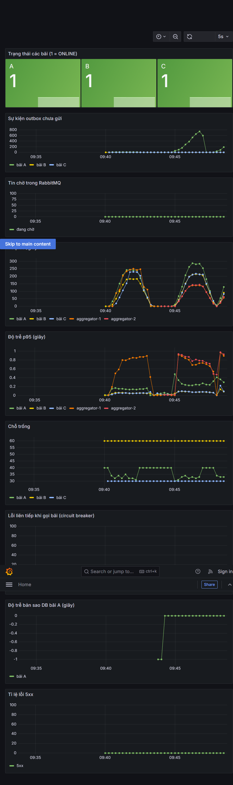

# Kết quả kiểm thử tải GS-05.3 → GS-05.5

> **Chưa có kết quả so sánh hợp lệ.** Hai lượt k6 chạy trong Docker trước đây hoàn tất kịch bản nhưng đồng hồ môi trường bị nhảy, làm hỏng phép đo `http_req_duration`. Không dùng p95 13 giây ở bảng dưới làm độ trễ thực của ứng dụng. Cần đồng bộ lại Docker Desktop rồi chạy lại hai lượt bằng k6 trong mạng Compose.

**Ngày chạy:** 2026-10-11  
**Kịch bản:** 200 VU tra cứu + 50 VU đặt chỗ, chạy 2 phút mỗi cấu hình; 10 chỗ bãi A, đặt thành công thì huỷ ngay.  
**Công cụ:** `grafana/k6` chạy trong Docker, gọi `http://aggregator:8000` trên mạng Compose.  
**Giám sát:** Prometheus và Grafana bật bằng profile `obs`.

## So sánh 1 bản và 2 bản Aggregator

Thời gian phản hồi là `http_req_duration`, đơn vị giây. `http_reqs` là tổng request (bao gồm cả tra cứu, đặt và huỷ).

| Cấu hình | `http_reqs` | Request/s | Tra cứu p50 / p95 / p99 | Đặt chỗ p50 / p95 / p99 | `http_req_failed` | Trạng thái số đo |
|---|---:|---:|---:|---:|---:|---|
| 1 Aggregator, không bật `ha` | 27.630 | 228,32 | 0,562 / 13,732 / 13,986 | 0,591 / 13,769 / 13,948 | 0,00% | Không hợp lệ: đồng hồ nhảy |
| 2 Aggregator, bật `ha` | 31.802 | 295,22 | 0,429 / 13,560 / 13,820 | 0,538 / 13,700 / 14,080 | 0,00% | Không hợp lệ: đồng hồ nhảy |

Hai lượt đều chạy đủ 200 VU tra cứu và 50 VU đặt chỗ trong 2 phút. Raw output báo p95 vượt ngưỡng trong `tests/load/k6.js`, nhưng không thể dùng để kết luận hiệu năng vì k6 ghi nhận `http_req_duration` âm tới khoảng -13 giây ở lượt chẩn đoán sau đó. Một request cùng `requestId` được k6 báo ~13,5 giây trong khi Aggregator ghi 186 ms và các node ghi 2–3 ms.

So sánh thêm các đồng hồ lúc kiểm tra cho thấy Windows host và WSL/Docker lệch khoảng 12 giây. Vì vậy không kết luận hai bản Aggregator tăng thông lượng 29% từ các lượt trên. Kết quả tham khảo (~470 request/s, p95 tra cứu 234 ms, đặt chỗ 245 ms) chưa được xác minh.

### Lượt chẩn đoán k6 Windows-native

Các lượt 30 giây này chỉ để khoanh vùng, không thay cho hai lượt so sánh 2 phút:

| Đường gọi | `http_reqs`/s | Tra cứu p95 | Đặt chỗ p95 | Lỗi HTTP | Ghi chú |
|---|---:|---:|---:|---:|---|
| `localhost:8000` | 219,47 | 1,10 s | 1,08 s | 0,49% | Chỉ đi vào Aggregator được publish cổng; có 34 check tra cứu lỗi |
| `localhost:3000` qua Nginx, 2 Aggregator | 220,30 | 1,26 s | 1,27 s | 0,31% | Không tương đương gọi alias nội bộ; có 22 check tra cứu lỗi |

K6 Windows-native không gặp p95 13 giây, nhưng đi qua port publish/Nginx thay vì mạng nội bộ Compose; do đó không dùng để so sánh chính thức. Cần đồng bộ thời gian của Docker Desktop trước khi chạy lại lệnh benchmark theo đúng mạng nội bộ.

## Kiểm tra bất biến

Chạy `node tests/load/check-invariants.mjs` sau từng lượt tải. Cả cấu hình 1 bản và 2 bản đều đạt: không có đặt chỗ chồng giờ, `request_id` trùng, hai phiên gửi xe mở trên cùng slot; outbox chưa gửi bằng 0 ở cả ba DB `db-a`, `db-b`, `db-c`.

## Ảnh Grafana

Ảnh được chụp khi đang chạy thêm một lượt tải HA 1 phút (250 VU), để ghi nhận dashboard trong lúc có tải. Lượt chụp này không được dùng trong bảng so sánh 2 phút.



## Cách chạy lại

```powershell
# 1 Aggregator
$loadDir = (Resolve-Path 'tests\load').Path
docker run --rm --network nhom16-parking_default `
  -e BASE=http://aggregator:8000 `
  -v "${loadDir}:/work:ro" grafana/k6 run /work/k6.js
node tests/load/check-invariants.mjs

# 2 Aggregator: bật profile ha theo hướng dẫn trong README.md,
# sau đó chạy lại hai lệnh trên với BASE giữ nguyên.
```

HA được bật cho lần đo bằng biến môi trường tạm thời của lệnh Compose; không sửa `.env`. Cụm khi kiểm tra có đủ ba nút RabbitMQ và DB replica A ở chế độ standby. Dashboard Grafana: http://localhost:3001.

Để chẩn đoán request chậm/lỗi mà không đổi kịch bản, có thể thêm `-e DEBUG_SLOW_MS=2000`; log sẽ chứa status, `X-Request-Id` và `X-Instance`.
