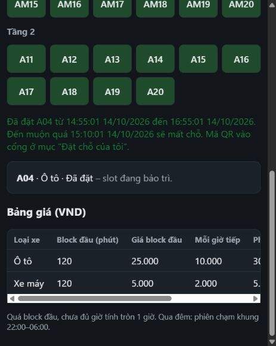
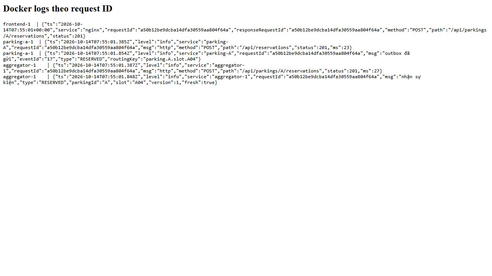

# GS-03.7 — Bằng chứng truy vết đặt chỗ theo request ID

**Luồng log đạt sau sửa nhỏ: đủ 5 chặng có cùng request ID. Phần ảnh header trong Network chưa hoàn thành.** Không dùng request ID khác để ghép chuỗi. Đã lưu log nguyên văn và ảnh quan sát thật.

## Môi trường và trạng thái trước thử

- Ngày 14/10/2026, đặt chỗ mẫu lúc **14:55:01 UTC+7** (07:55:01 UTC).
- Nhánh lưu kết quả: `hung-gs-03-7`, tách riêng thay đổi GS-03.7 từ `dev` đã fetch và cập nhật fast-forward theo yêu cầu người dùng. Git sạch trước khi bắt đầu; không có AGENTS.md trong repository.
- Commit nền: **`1519d4c8b924c9376265db8880a1bfc5f439b900`**. Lần thử dùng commit này **cộng thay đổi chưa commit** ở `frontend/nginx.conf` và `parking-node/src/relay.js`; không tuyên bố commit nền nguyên trạng đã có đủ 5 log.
- PT-06.4 đã được người dùng kiểm tra; `origin/codex/hung-pt-06-4` có commit `166a912`, cập nhật PR #10. Không nhập tài liệu PT-06.4 vào nhánh này.
- Windows/PowerShell, Node.js v24.11.0, Docker Engine 29.1.5, Compose 5.0.1. Một Aggregator, ba node, database và broker dự án đang chạy; RabbitMQ healthy.
- Sau PT-06.4, Toxiproxy vẫn tồn tại nhưng `parking-b: BẬT bình thường`, không toxic; web có A/B/C ONLINE. Thử GS-03.7 ở bãi A.
- Giữ override RabbitMQ cục bộ ngoài Git để tránh cổng đang bị container RabbitMQ khác chiếm và healthcheck quá ngắn. Không xoá volume/database hoặc thay thông tin xác thực.
- Web `http://localhost:3000`, đăng nhập demo user1; tạo một đặt chỗ hợp lệ ở A04. Không đưa biển số mẫu, nội dung request body, header Authorization, mật khẩu hoặc token vào bằng chứng.

## Cơ chế và sửa đổi tối thiểu

Trên code nền, nginx đặt `X-Request-Id` bằng `$request_id`; middleware Aggregator/node nhận ID hợp lệ, trả header cùng ID và dùng AsyncLocalStorage cho log HTTP. Aggregator chuyển header xuống node; node ghi ID truy vết vào `parking_events.payload.requestId`. Publisher gửi payload và AMQP correlation ID. Consumer Aggregator log `e.requestId` khi nhận sự kiện.

Hai chặng thiếu bằng chứng log trên code nền:

1. Access log mặc định nginx không ghi request ID.
2. Relay không log từng sự kiện sau khi gửi thành công.

Đã bổ sung:

- `frontend/nginx.conf`: JSON access log gồm thời điểm, service nginx, `$request_id`, **`$upstream_http_x_request_id`**, method, URI không có query string và status. Không ghi header xác thực/body/IP/người dùng.
- `parking-node/src/relay.js`: log `outbox đã gửi` sau publisher confirm và cập nhật `published_at`, lấy ID từ payload outbox; ghi event ID, loại sự kiện và routing key. Không lấy ID từ ngữ cảnh timer hoặc mã idempotency.
- `parking-node/test/relay.test.js`: kiểm tra broker lỗi không có log gửi thành công; broker xác nhận thì log đúng trace ID khác mã idempotency, đánh dấu outbox, không log lại khi queue đã xử lý.

Build và áp dụng lại đúng frontend/parking-a để log mới hoạt động, giữ database và mạng:

```powershell
docker compose build parking-a frontend
docker compose -f docker-compose.yml -f docker-compose.chaos.yml -f "$env:TEMP/nhom16-tc37-healthcheck.yml" --profile chaos up -d --no-deps --no-build parking-a frontend
docker compose exec -T frontend nginx -t
```

Các node B/C không được recreate trong phép thử này; chúng vẫn chạy image cũ, nên không khẳng định đã kiểm thử log relay mới ở B/C.

## Ba loại mã của mẫu

| Mã | Giá trị | Vai trò |
| --- | --- | --- |
| Request ID truy vết | **`a50b12be9dcba14dfa30559aa804f64a`** | Header X-Request-Id, JSON log `requestId`, payload outbox và AMQP correlation ID. |
| Idempotency-Key | `d6656c41-b2eb-4f30-851d-8aa35668cd65` | Khoá chống tạo đặt chỗ trùng khi retry cùng thao tác. Không dùng để lọc log truy vết. |
| Reservation ID | `703fd87e-58d9-4559-8ce7-73ad7b1b4e34` | Mã bản ghi đặt chỗ, dùng để huỷ dữ liệu test. Không phải request ID. |

`reservations.request_id` trong schema là khoá idempotency ghép với user ID; **khác** `parking_events.payload.requestId` dùng truy vết. Bảng trên chỉ trích phần key, không công bố user ID từ DB.

### Cách lấy request ID trong lần thử này

Đã thao tác trên web thật và nhận kết quả thành công. Công cụ trình duyệt trong Codex không có API Network/DevTools; thử F12 không mở bảng Network. Vì vậy **chưa đọc trực tiếp Response Headers trong Network**.

Giá trị mẫu được lấy từ trường **`responseRequestId`** của access log nginx cho đúng POST `/api/parkings/A/reservations`, status 201. Trường đó là `$upstream_http_x_request_id`, tức header response thật nhận từ Aggregator; `requestId` của nginx bằng cùng giá trị. Cấu hình proxy hiện không đổi hoặc ẩn header này. Đây là bằng chứng bổ sung phía proxy, **không thay thế ảnh Network hoặc tuyên bố đã chụp Network**.

## Bảng bằng chứng 5 chặng

Tất cả các dòng sau có **đúng `requestId=a50b12be9dcba14dfa30559aa804f64a`**. Số dòng trỏ vào [log nguyên văn đã lọc](gs-03-7-log-request.txt), không ghép sự kiện bằng mã khác.

| Chặng yêu cầu | Service/container | Thời điểm UTC+7 | Dòng log chứng minh |
| --- | --- | --- | --- |
| nginx | nginx / frontend-1 | 14:55:01, độ phân giải giây | Dòng 1: `responseRequestId=a50b12be9dcba14dfa30559aa804f64a`, POST `/api/parkings/A/reservations`, status 201; requestId cũng bằng mã này. |
| Aggregator xử lý HTTP | aggregator-1 | 14:55:01.387 | Dòng 4: `msg=http`, POST `/api/parkings/A/reservations`, status 201, ms 27. |
| Parking node | parking-A / parking-a-1 | 14:55:01.385 | Dòng 2: `msg=http`, POST `/api/reservations`, status 201, ms 23. |
| Outbox relay | parking-A / parking-a-1 | 14:55:01.854 | Dòng 3: `msg=outbox đã gửi`, eventId 17, type RESERVED, routingKey `parking.A.slot.A04`. |
| Aggregator nhận sự kiện | aggregator-1 | 14:55:01.848 | Dòng 5: `msg=nhận sự kiện`, type RESERVED, parkingId A, slot A04, version 1, fresh true. |

Log HTTP ghi lúc response hoàn tất, nên node có timestamp trước log hoàn tất HTTP của Aggregator. Consumer nhận sự kiện (.848) có thể log trước relay cập nhật DB/log sau publisher confirm (.854); điều này không có nghĩa nhận trước publish. Thứ tự chặng trong bảng là luồng nghiệp vụ, không phải ép các timestamp tăng dần. Output Docker cũng được nhóm theo container, không phải timeline toàn cục.

Outbox đối chiếu trực tiếp:

```text
eventId: 17
type: RESERVED
payload.requestId: a50b12be9dcba14dfa30559aa804f64a
payload.reservationId: 703fd87e-58d9-4559-8ce7-73ad7b1b4e34
published_at: 2026-10-14 07:55:01.853007+00
```

Không dump toàn bộ payload hoặc response chứa QR token. Bản đặt chỗ test đã huỷ qua API node A: **HTTP 200, CANCELLED**. Mạng B vẫn bình thường sau thử.

## Tái hiện và lọc log

1. Bật hệ thống, đợi A/B/C ONLINE và RabbitMQ healthy; áp dụng build có hai bổ sung log nêu trên.
2. Mở web, đăng nhập user1, chọn slot trống, nhập biển số giả chỉ phục vụ test và bấm Đặt ngay một lần.
3. Trên trình duyệt có DevTools: mở Network **trước** thao tác, chọn POST `reservations`, đọc **Response Headers → X-Request-Id**. Không dùng Request Headers để chụp vì có thể lộ Authorization.
4. Thay ID trong lệnh dưới bằng đúng header của thao tác đó; không dùng lại ID mẫu cho thao tác mới.

PowerShell:

```powershell
$traceId = 'a50b12be9dcba14dfa30559aa804f64a'
docker compose logs --no-color | Select-String -SimpleMatch $traceId
```

CMD:

```cmd
docker compose logs --no-color | findstr /L /C:"a50b12be9dcba14dfa30559aa804f64a"
```

Lệnh lọc thực tế đã chạy theo đúng mẫu PowerShell. Bản bằng chứng lưu chỉ giữ các dòng frontend, parking-a và aggregator cần cho 5 chặng, bỏ dòng notification có trường người nhận không cần thiết. Các dòng được giữ nguyên văn, không sửa timestamp hoặc ID.

## Kết quả kiểm thử

- `node --test parking-node/test/relay.test.js`: **4 pass, 0 fail**, gồm test GS-03 mới, broker lỗi/khôi phục/thứ tự và chống chạy chồng.
- `node --test --test-name-pattern 'GS-03' aggregator-service/test/routes.test.js`: **1 pass, 0 fail**, xác nhận header truyền Aggregator → node → payload outbox và response.
- Build Docker parking-a/frontend thành công; `nginx -t` thành công; `git diff --check` đạt.
- Đặt chỗ thực tế trên web: **201**, đủ 5 log cùng request ID, outbox published và consumer `fresh=true`.
- Chưa chụp Network: **chưa hoàn thành phần bằng chứng ảnh header**, không báo đạt toàn bộ yêu cầu lưu ảnh.

## Ảnh thực tế và phần cần bổ sung





Ảnh log là screenshot thật của trình duyệt đang hiển thị nguyên văn file log đã lọc, không phải ảnh terminal/DevTools. File text liên kết phía trên là nguồn gốc để đối chiếu. Trang hiển thị tạm trong container frontend đã được gỡ sau chụp, không thêm route/UI vào code dự án.

### Bổ sung ảnh Network

- Mở Chrome/Edge, nhấn F12 → Network → bật Preserve log → Fetch/XHR.
- Tạo một đặt chỗ test mới, chọn đúng POST `reservations`, mở Headers và chỉ chụp **Response Headers** cùng status/method. Không để vùng Request Headers, Authorization, Cookie, Payload hoặc Response body có token xuất hiện.
- Lưu ảnh thật vào `tai-lieu/anh/gs-03-7-network-header.jpg` (hoặc phần mở rộng đúng định dạng ảnh).
- Vì thao tác mới có ID mới, lọc lại Docker logs bằng đúng ID từ ảnh, cập nhật bảng/file log/ảnh log tương ứng cho **cùng một thao tác mới**, rồi huỷ reservation đó. Không ghép ảnh header mới với chuỗi log ID mẫu cũ.
- Chỉ sau khi có ảnh khớp này mới đánh dấu phần bằng chứng Network hoàn thành và kết luận toàn bộ yêu cầu đạt.

## Checklist người kiểm tra

- [ ] Đối chiếu cùng request ID ở cả 5 dòng trong file log, bảng và ảnh log.
- [ ] Phân biệt trace ID, Idempotency-Key và reservation ID.
- [ ] Kiểm tra diff chỉ bổ sung log, không thay nghiệp vụ đặt chỗ/publish/ack.
- [ ] Chạy lại 4 test relay và test GS-03.
- [ ] Bổ sung ảnh Network và cập nhật cả bộ bằng chứng cùng request ID mới theo hướng dẫn.
- [ ] Không lưu dữ liệu xác thực hoặc dữ liệu cá nhân trong ảnh/báo cáo.

Kết luận: **truy vết đủ 5 chặng đạt sau bổ sung log tối thiểu; bộ bằng chứng chưa hoàn chỉnh vì thiếu ảnh Network trực tiếp.**
