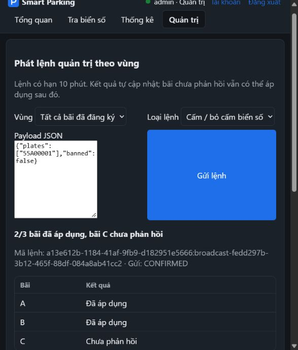
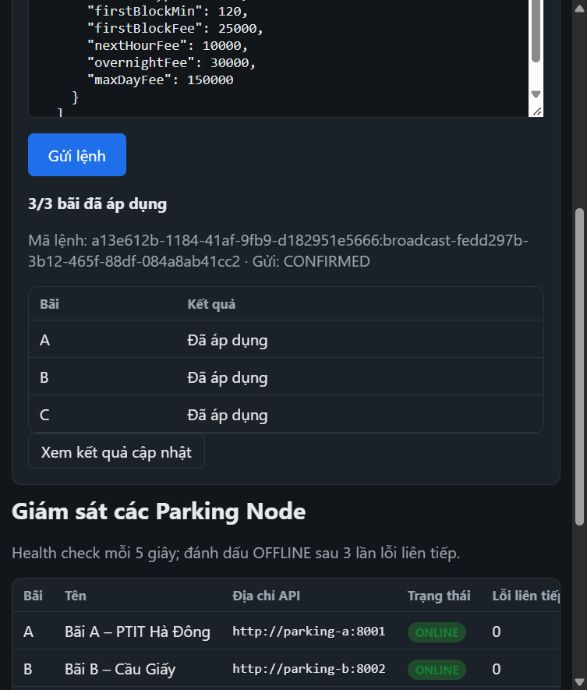

# PD-04 — Bằng chứng thực tế 23/10/2026

Base dev `0f8eae8`, PD-03 #52 còn open/unmerged. Không có E/F hay vùng etcd trong dev. **TC61 D/E/F chưa đạt, PR draft.**

| Kiểm tra | Kết quả quan sát |
|---|---|
| Hồi quy parking-node | 46 pass, 0 fail trên PGlite; sau đó 2 test admin mới pass, 0 fail |
| Unit/integration Aggregator | 41 pass, 0 fail, 3 broker test opt-in skipped; sau thay đổi cuối chạy lại focused 12/12 pass (broadcast + publisher) |
| Frontend | `npm run build`: Vite 8.3.2, 107 modules, đạt sau sửa form responsive |
| HTTP e2e Docker | 12 pass, 0 fail, 1 chaos test skip vì chưa bật toxiproxy |
| Broker + Postgres candidate | 7 pass, 0 fail; 1 TC61 D/E/F skip có lý do cụ thể |
| RabbitMQ Management | `/`, 2 exchanges, 7 quorum queues, 10 bindings, 2 policies, permissions; queue sự kiện mặc định có consumer, không tạo sẵn aggregator-2 |
| Giao diện thật | Đăng nhập admin demo, gửi banPlates bỏ cấm biển giả khi C dừng: 2/3; bật C rồi reload trang, xem cùng mã broadcast: 3/3; form được chỉnh cho viewport hẹp |

Broker candidate dùng inbox PD-02 `238b776` và signed reply hook PD-03 `fd9d781`, ghép patch PD-04 vào thư mục test riêng. Không đưa code inbox/request–reply chưa merge vào PR này. Script `scripts/prepare-pd04-candidate.mjs` đã chạy thành công; nội dung commands/index/slots sau chuẩn hóa newline khớp candidate đã build/test. Mọi node candidate có cờ admin bật; phần service thực tế trên dev còn chờ dependency.

Các kiểm chứng broker:

1. 10 HTTP request trùng key chỉ **một publish** quan sát qua queue probe, cùng broadcastId. AMQP persistent, correlationId chung, replyTo `agg.broadcast`, expiration gần 600000. Republish chính xác bản wire: mỗi DB một inbox row, có phản hồi lặp mà không thêm hiệu lực.
2. Dừng C: kết quả A/B applied, C missing. Bật sau hơn 12 giây; vòng kiểm chứng hoàn tất sau khoảng 17 giây, C applied, đúng một inbox row. Restart C thêm lần nữa: bảng giá giữ nguyên.
3. Envelope admin đã quá hạn: node lưu 410 trong inbox, không đổi giá.
4. Hạn tổng gốc còn 250 ms, C đang dừng: broker chuyển bản C sang `cmd.expired`; bật C không có inbox/effect muộn. Thời hạn tổng vẫn là `deadlineAt=issuedAt+600000`, không cấp lại 10 phút; expiration bằng thời gian còn lại. Test ack đúng record expired của fixture, không purge queue.
5. Management xác nhận chỉ queue admin có binding vùng/all, quorum/SAC, policy TTL 600000; consumer user/admin prefetch 16/4. Test 401/403, vùng không có, payload sai.
6. Floor fixture 99: broadcast khóa, giao lại vẫn slot version 1; HTTP không mở khóa trái broadcast. Cấm biển fixture rồi restart A: trạng thái bảo trì và biển cấm còn trong DB; đặt chỗ bị 403. Bỏ cấm/mở tầng và dọn đúng fixture sau test.

Log nguyên bản: [broker](pd-04-broker.log), [HTTP e2e](pd-04-http-e2e.log), [focused unit](pd-04-focused-unit.log).

Ảnh trên chụp trước chỉnh form responsive. Cùng mã broadcast sau C bật lại, tải lại trang và mở Quản trị:

Các lần thử không đạt và cách sửa:

- Lần hồi quy HTTP đầu thiếu `COMPOSE_PROJECT_NAME`/`COMPOSE_FILE`, lệnh điều khiển container chạy nhầm project mặc định trong khi HTTP trỏ stack thử. Kết quả đó không tính đạt. Đã dừng lại những container project mặc định được bật bởi test (trước đó đều dừng), giữ nguyên ba container unrelated ban đầu và dữ liệu; chạy lại project `pd04-broadcast` đạt 12/13, 1 skip.
- Lần broker mở rộng đầu kiểm Management ngay sau restart C, snapshot consumer chưa có đủ prefetch, nên test fail. Đã đổi sang chờ điều kiện consumer hiện hữu có timeout; lần chạy đầy đủ cuối đạt 7 pass/1 skip.
- Patch tạo trên Windows ban đầu bị CRLF khiến `git apply --check` không khớp base LF. Đã chuẩn hóa patch LF và kiểm script tái lập thành công trên thư mục mới; không sửa checkout dependency.

Đã khôi phục A/C, giá ban đầu, xóa đúng slot/ban/inbox/outbox/broadcast fixture; đăng xuất tài khoản demo. Stack thử kết thúc bằng `docker compose down` không `-v`; không xóa database/volume. Các kiểm chứng này không thay thế TC61 trên môi trường 6 bãi, tích hợp PD-06/PD-09/PD-12, hoặc CI của PR. CI được ghi nhận riêng tại thời điểm bàn giao.
