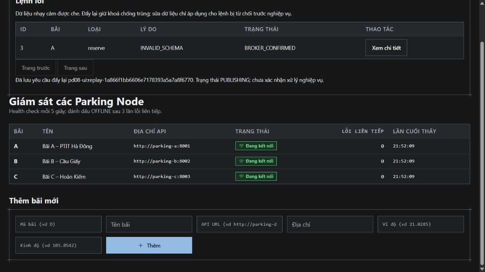

# PD-08 — Cập nhật và kiểm chứng 01/11/2026

## Dependency và phạm vi

Đã đọc Issue #25, hợp đồng #23, kế hoạch v1.4 mục 5.6, tài liệu phân công và nhận xét 01/11 trong dev. Không có AGENTS.md trong repo/đường dẫn cha đã kiểm. Dev tại `eef361f` đã có PD-01/PD-02. Tiếp tục nhánh `hung-pd-08-retry-dlq` và PR #49, không tạo trùng. Ref `hung` hiện hữu nên giữ dạng dấu gạch ngang đã được người giao việc cho phép trước đó.

Đã nhận dev vào nhánh hiện hữu, giải quyết bốn xung đột, giữ config/etcd/leader/fencing/PD-18 relay/scheduled lock mới. Retry nối trực tiếp entrypoint parking-node; xóa patch và retry-integration.js. TC57/TC58 chạy source trong repo, không cần PD02_SOURCE_ROOT hoặc candidate ngoài. Không sửa PD-03/PD-04, không merge PR vào dev.

PD-03/bảng commands và consumer expired PD-06 chưa có trên dev. Hook markFailed còn chờ tích hợp; không tạo bảng commands thay thế. Điểm cần chốt với PD-06: deadline tuyệt đối/clock skew, thời điểm EXPIRED khi node offline sau retry (broker bỏ expiration), khoảng final DB check–COMMIT. Không tuyên bố đã giải quyết toàn bộ TTL/back-pressure/FAILED/Socket.IO.

## Kết quả thực tế

| Kiểm tra | Kết quả |
|---|---|
| TC57/TC58 entrypoint service thật | 4 pass, 0 fail, 0 skip (parent + 3 tình huống) |
| Component trên RabbitMQ/PostgreSQL, source hiện tại | 7 pass, 0 fail, 0 skip |
| Hồi quy parking-node | 84 pass, 0 fail, 1 opt-in PostgreSQL skip |
| Hồi quy Aggregator | 65 pass, 0 fail, 3 live opt-in skip |
| Focused inbox/consumer/retry sau thay đổi deadline | 20 pass, 0 fail |
| Publisher/DLQ/retry/transfer/claim sau thay đổi cuối | 27 pass, 0 fail; không cộng trùng các test với full regression |
| HTTP/inbox e2e stack thật | 16 pass, 0 fail, 12 skip (HA/coord/chaos/PD-03 chưa bật) |
| Frontend build | Đạt, Vite 8.3.2, 108 modules |
| Management API | Vhost /, 7 quorum command queues, 7 bindings, 2 policies, permissions đúng; event queues mặc định có consumer, không pre-create aggregator-2 |

Log được giữ trong thư mục này: `pd-08-runtime-2026-11-01.log`, `pd-08-component-2026-11-01.log`, `pd-08-e2e-2026-11-01.log`, `pd-08-node-unit-2026-11-01.log`, `pd-08-agg-unit-2026-11-01.log`, `pd-08-focused-2026-11-01.log`, `pd-08-publisher-dlq-2026-11-01.log`, `pd-08-topology-2026-11-01.log`.

### Các bằng chứng chính

- TC57 runtime đi qua index service thật: khoảng 2 s rồi 10 s, giữ cùng messageId/correlationId/replyTo/actor/traceparent, đúng một reservation. DB B/C không có inbox của ID đó. Hạn tổng test 60000 ms; production vẫn mặc định 10000 ms.
- Component đo khoảng 2049 ms và 10025 ms. CC hoạt động trên RabbitMQ 3.13: retry.N vẫn là fields.routingKey, bản sao đến đúng queue/bãi/type; adapter xác thực route gốc trước gọi processor. Không phát sang B/C.
- TC58 worker thật nhận schemaVersion=2, lưu dead_letters trước ack. API admin sửa payload, fence ID cũ bằng inbox, relay replay một ID mới ổn định; DB đúng một hiệu lực. UI thử thêm một fixture riêng: xem dữ liệu đã che, sửa payload, Đẩy lại, thấy BROKER_CONFIRMED và DB có một reservation. Confirm được ghi rõ chưa chứng minh nghiệp vụ hoàn tất.
- Test giữ khóa slot trong DB qua deadline 300 ms: node rollback reservation/inbox/slot/outbox mới, chuyển expired; không thực hiện muộn. Test khác deadline 500 ms xuyên retry 2 giây không reset; TTL 50 ms/node dừng không có hiệu lực khi trở lại.
- Unit xác nhận ack sau confirmed transfer, transfer fail đóng nguồn unacked, concurrent basic.return/confirm ghép đúng attempt; retry cạn vào DLQ, business 409 không retry; DLQ duplicate một dòng; admin quyền/validation; edited replay không vượt kết quả inbox đã có.
- Publisher nhận issuedAt/deadlineAt đã lưu thì giữ nguyên, dùng thời gian còn lại, không cấp lại factory TTL. Bản giao lại đã có kết quả inbox có thể trả kết quả cũ sau deadline mà không chạy nghiệp vụ. Hồi quy TC52 và TC53 crash sau COMMIT/trước ack đều qua trên node đã tích hợp retry.

## Môi trường và khôi phục

Project riêng `pd08-nov01`, override `tests/pd08-compose.test.yml`; broker 5673/15673, PG A 15432, PG Aggregator 15433. Không đụng rabbitmq:5672, airflow, superset-bi đang chạy từ trước. Hook lỗi chỉ NODE_ENV=test và đúng ID `pd08-runtime:retry`, mặc định production tắt. Runtime test yêu cầu project prefix pd08-* và tự dọn IDs/slots riêng.

Ban đầu Management được gọi trước notification consumer sẵn sàng và trong lúc e2e đang dừng broker: các lần đó không tính đạt. Đã chờ toàn bộ e2e hoàn tất rồi chạy Management lại, kết quả pass được lưu riêng. Không sửa topology hoặc xóa dữ liệu để né lỗi. Mọi fixture PD-08/UI được dọn theo ID, đăng xuất demo; khôi phục node/service trước tắt stack riêng bằng down không -v. Không xóa database/volume.

Job CI `retry-dlq` được thêm để tự dựng stack thường, chạy runtime TC57/TC58 rồi component tests trên source hiện tại, không skip âm thầm vì thiếu checkout ngoài. Kết quả CI của commit bàn giao sẽ được cập nhật trong PR; kết quả ở bảng trên là quan sát local thực tế.